# Weldments

A weldment is a frame built from structural stock (tube, angle, channel, beam) laid along the
lines of a skeleton sketch, plus the plates and welds that hold it together. SolidCraft cuts each
member to length, joins the corners, and keeps a **cut list** of what to saw and what to buy.

This walkthrough builds a 1000 × 600 mm frame of SHS 40×40×3 tube with a crossbar, corner gussets
and a weld, then reads the cut list. The numbered rings in the pictures are the clicks, in order.

## 1. Sketch the skeleton

Each line of the skeleton becomes one member, centred on the line by default.

1. **Model → New Sketch** (`sketch.create`) and pick the **XY** plane.
2. **Rectangle** from the origin, then a **Line** across the middle for the crossbar.
3. **Dimension** the sides: 1000 mm and 600 mm.
4. **Finish Sketch**.

The sketch panel shows **Untied 2** here: the crossbar's ends touch the rails' lines by position
only. Click **Tie** (circled) to keep them on the rails when you change the frame's size; a Midpoint
constraint also keeps the crossbar centred.

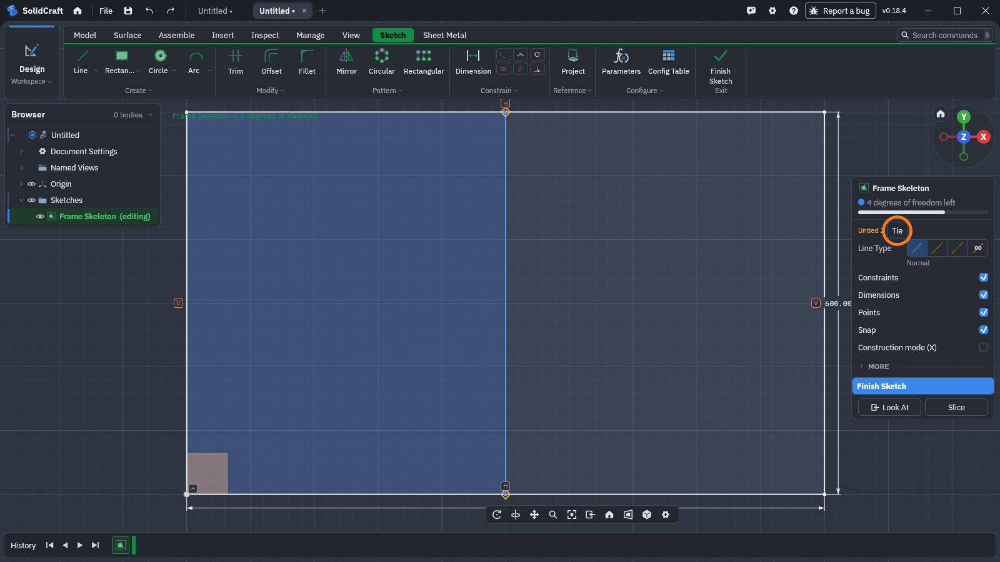

## 2. Add structural members from the profile library

1. **Model → Member** (`weld.member`) opens **Structural Member** (①). Set **Profile from**
   (②) to choose where the cross-section comes from.

   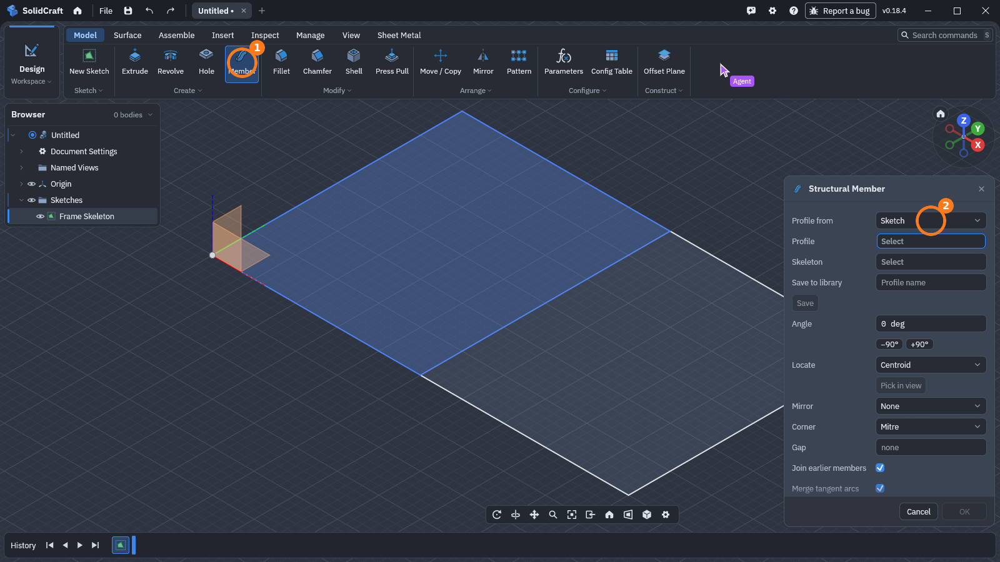

2. Choose **Library** (①). **Sketch** uses a closed profile you drew yourself instead.

   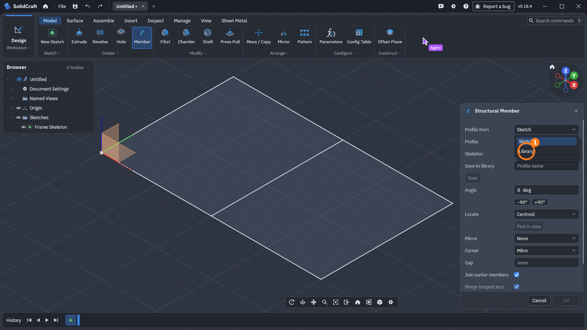

3. The library holds about 240 standard sections: SHS, RHS, CHS, HSS, pipe, angle (L), channel
   (C, UPN, UPE), beams (IPE, HEA, HEB, W), flat bar, round and square bar. Narrow it with
   **Type**, or type in **Search** (①): `SHS 40` leaves three. Pick **40x40x3** under **Size**
   (②). The line under it shows the section's size and area.

   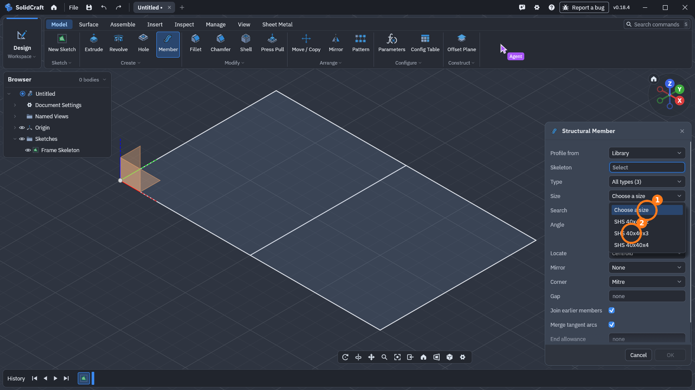

4. With **Skeleton** active, click the lines (① to ⑤). The preview updates as you pick: corners
   where two members end are mitred (**Corner: Mitre**), and the crossbar stops at the inside
   faces of the rails.

   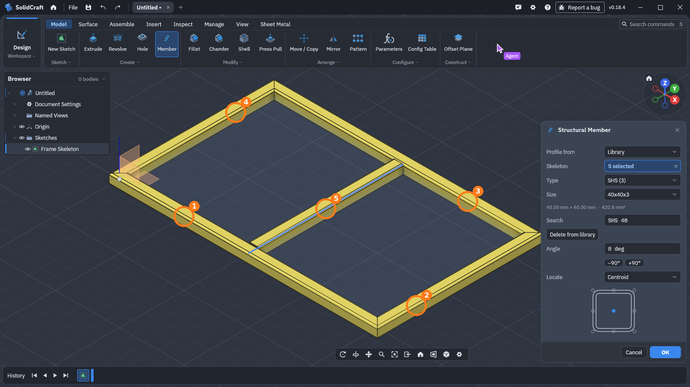

   Other settings: **Angle** turns the profile about its line, **Locate** picks which point of
   the profile sits on the line (centroid, a corner, an edge midpoint, or a point picked in the
   view), **Corner** switches between mitre and butt joints, and **Gap** leaves room between
   members at the joints.

5. **OK**. The first member adds a **Weldment** tab (①) to the ribbon and a **Cut List** entry
   to the browser.

   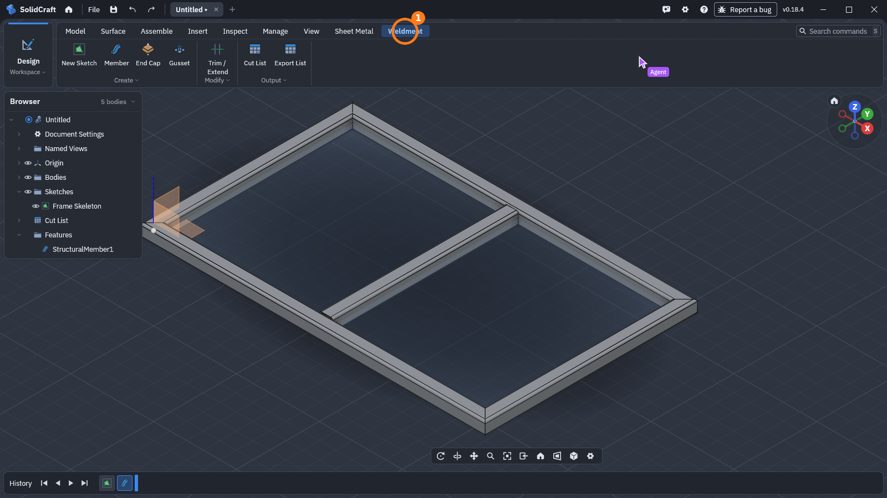

You can save a profile you sketched yourself to the library with **Save to library** in the same
dialog (`weld.profile_save`), and use it in other designs.

## 3. Gussets and end caps

**Weldment → Gusset** (`weld.gusset`, ①): pick two members whose lines meet. The plate lies in
the corner between them, its legs along the faces that face each other. **Size** is the leg
length, **Thickness** the plate, and **Corner clip** cuts the inside corner back to clear the weld.

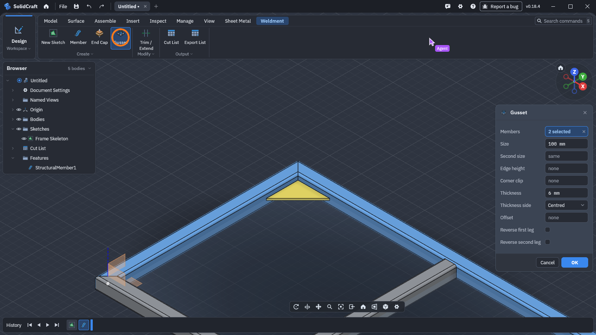

Repeat for the other corners:

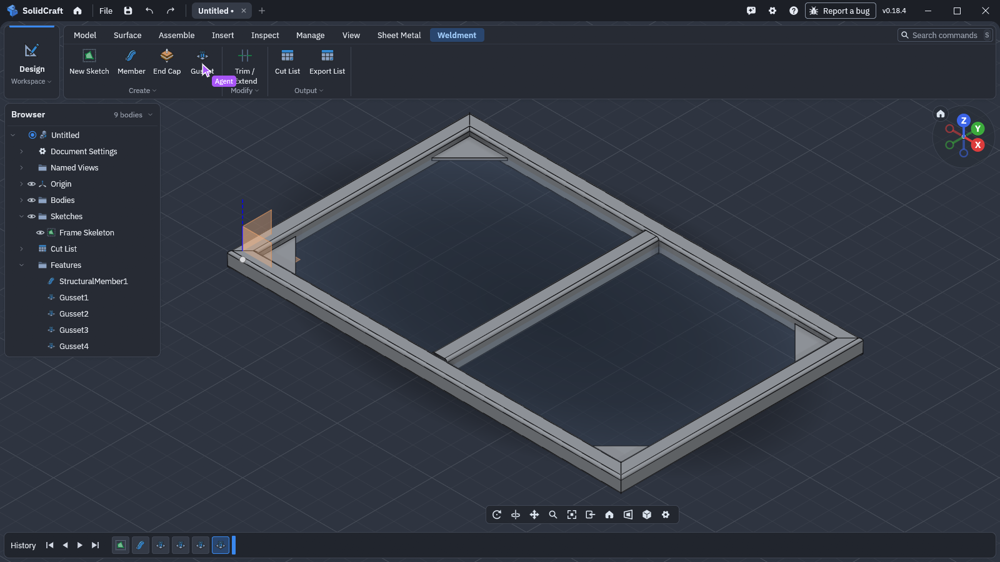

**End Cap** (`weld.end_cap`) closes an open end of a tube with a plate, either on the end face
or fitted inside. Mitred corners have no open ends, so this frame has none.

## 4. Set the material

Masses in the cut list come from each body's physical material. Members start out with the
default material, which is far lighter than steel (a 1040 mm rail weighs 0.54 kg instead of
3.30 kg), and the Cut List says so while any body still has it:

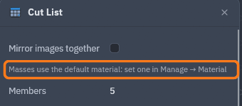

Set the material before you read the masses: **Manage → Material** (`material.assign`), drag a
box over the frame to pick every body, choose **Steel** (①), **OK**.

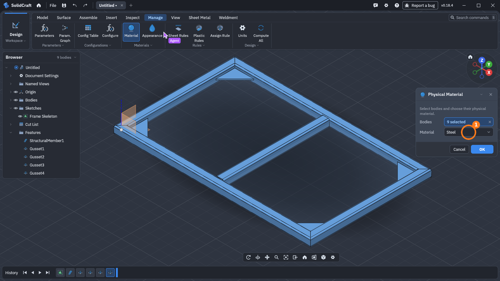

## 5. Weld beads

**Weldment → Create ▾ → Weld Bead** (`weld.bead`, ①). Pick the two bodies to join, here the
crossbar and the front rail, and set the fillet **Size**. The seams are found where the bodies
meet. **Intermittent** makes stitch welds (length and pitch), **Field weld** marks a weld made on
site, and **Note** is the text for the weld symbol's tail.

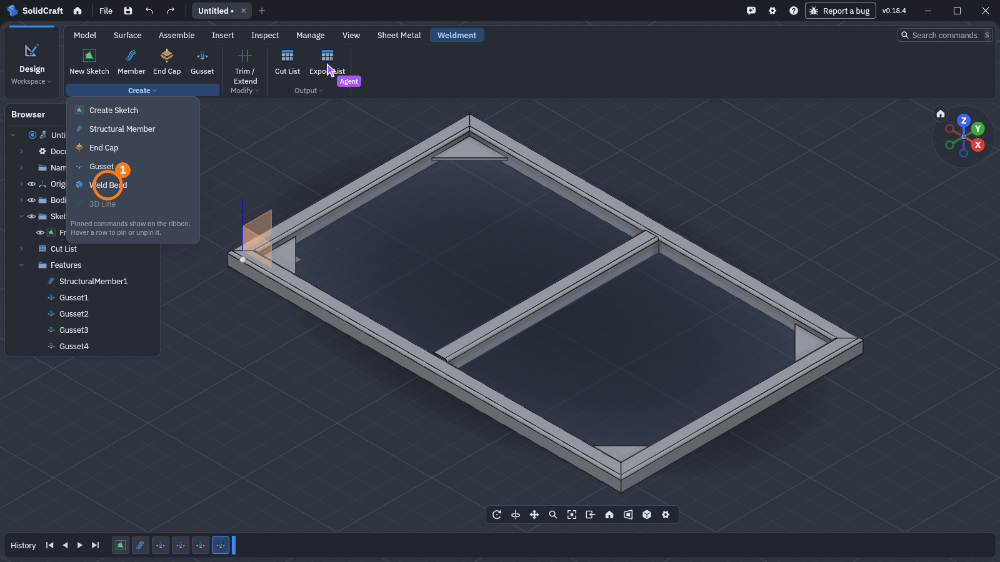

Beads are cosmetic: they add no material and change no body, but the cut list counts them.

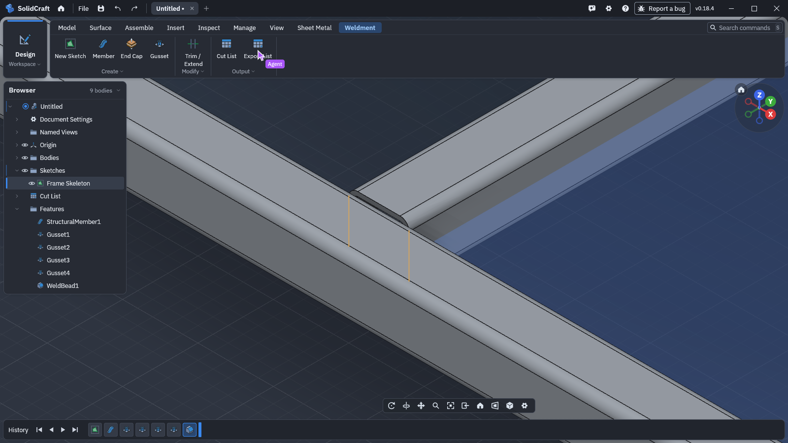

A seam is only found where the two faces actually meet. Here the crossbar and the rail are the
same 40 × 40 tube, so at the top and bottom the crossbar's flat end meets the rail's rounded
corners and leaves a groove: the bead finds the two side flats (two seams, 58 mm in all). To weld
all the way round, set **Gap** to how wide the groove may be: with a 6 mm gap the same bead is one
closed seam of 150 mm round the crossbar's whole outline.

## 6. The cut list

**Weldment → Cut List** (`weld.cut_list`, ①):

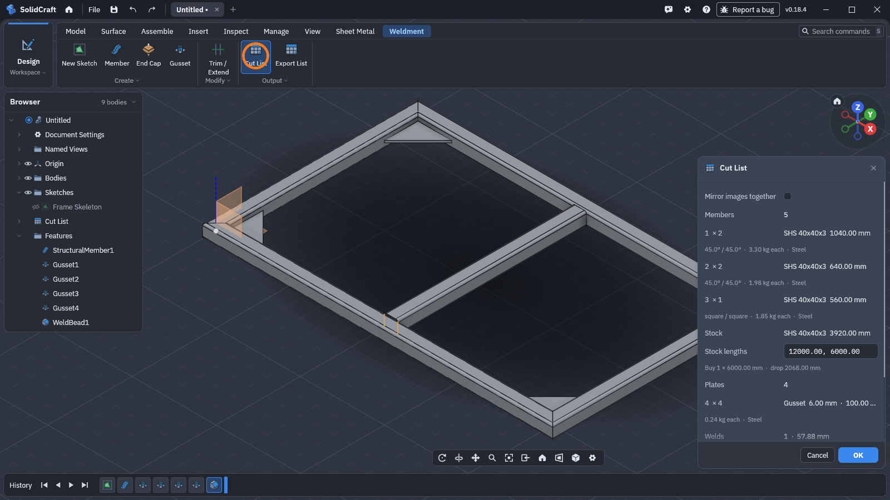

- **Members**: identical members share a row, with quantity, stock, length and end cuts. The
  rails are 1040 mm (1000 mm plus the mitres at the long points), the end rails 640 mm, and the
  crossbar 560 mm with square ends.
- **Stock**: the total length of each stock. **Stock lengths** are the lengths you buy it in
  (from the library profile; edit them here for this design, `weld.stock_lengths`). Below that is
  what to buy: one 6000 mm bar, with 2068 mm left over after a 3 mm saw kerf per cut.
- **Plates**: gussets and end caps with their thickness, size and mass.
- **Welds**: beads, their count and seam length.

Scroll down for the welds, **Edit item** and the export buttons:

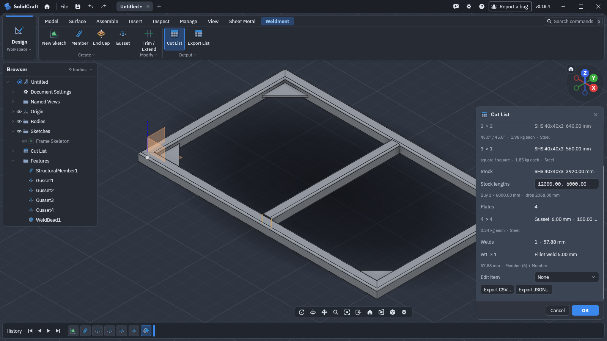

**Edit item** sets a row's description or extra properties (`weld.cut_properties`), or leaves
bodies out of the list. **Mirror images together** puts a member and its mirror image in one row.
Members within 0.1 mm and 0.05° of each other share a row. Change the tolerances in
**Preferences**.

**Export CSV…** and **Export JSON…** in the dialog, or **Export List** on the ribbon
(`weld.export_cut_list`), save the same tables:

```text
item,qty,description,length_mm,end1,end1_mitre_deg,end1_bevel_deg,end2,end2_mitre_deg,end2_bevel_deg,mass_kg,material,members,mirror_of,mirrored,profile
1,2,"SHS 40x40x3",1040.000,mitre,45.0000,0.0000,mitre,45.0000,0.0000,3.3035,"Steel","Member;Member (3)",,"","SHS 40x40x3"
2,2,"SHS 40x40x3",640.000,mitre,45.0000,0.0000,mitre,45.0000,0.0000,1.9821,"Steel","Member (2);Member (4)",,"","SHS 40x40x3"
3,1,"SHS 40x40x3",560.000,square,0.0000,0.0000,square,0.0000,0.0000,1.8499,"Steel","Member (5)",,"","SHS 40x40x3"

item,qty,plate,thickness_mm,width_mm,height_mm,area_mm2,mass_kg,material,bodies,description
4,4,gusset,6.000,100.000,100.000,5000.00,0.2355,"Steel","Gusset;Gusset (2);Gusset (3);Gusset (4)",""

stock,bar,length_mm,items,cuts_mm,drop_mm
"SHS 40x40x3",1,6000.000,"1;1;2;2;3","1040.000;1040.000;640.000;640.000;560.000",2068.000

weld,qty,kind,size_mm,length_mm,welds,intermittent_length_mm,pitch_mm,field,volume_mm3,mass_kg,beads,bodies,note
1,1,fillet,5.000,57.883,2,,,false,723.53,0.0057,"WeldBead1","Member (5)+Member",""
```

## More

- **Trim/Extend** (`weld.trim_extend`) cuts members back or lengthens them to a plane, a face or
  other members, and can cope a tube to fit round another.
- An arc in the skeleton makes a bent member, with bender steps (feed, rotation, angle) in the cut
  list. A spline makes one formed to shape, and a circle makes a ring.
- **Sub-weldments** (`weld.sub_weldment`) group bodies into a cut list section of their own.
